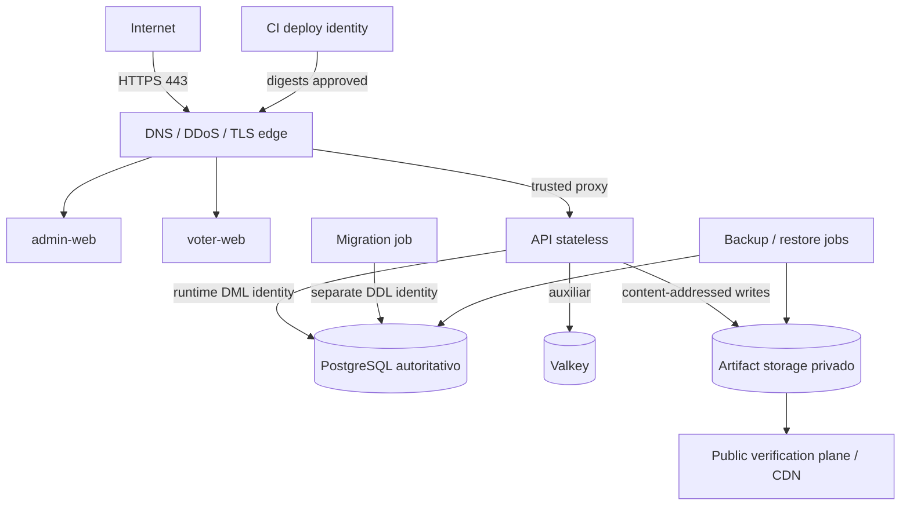

# Topología y trust boundaries

| Boundary | Confianza y regla |
| --- | --- |
| Internet → edge | datos hostiles; TLS, límites, timeouts y abuso antes de la API |
| edge → aplicación | solo proxies/CIDR aprobados; conservar bytes criptográficos |
| aplicación → datos | red privada; identidades distintas por runtime/migration/backup |
| aplicación → artifacts | escritura inmutable por digest; público y privado separados |
| humano/CI → management | cuentas nominales, MFA, least privilege y audit |

Solo el edge tiene ingress público. PostgreSQL, Valkey, métricas y artefactos
internos no publican puertos. `CastVote` no necesita egress irrestricto. No se
declara HA ni multi-región hasta aprobar RPO/RTO y probar failover.
